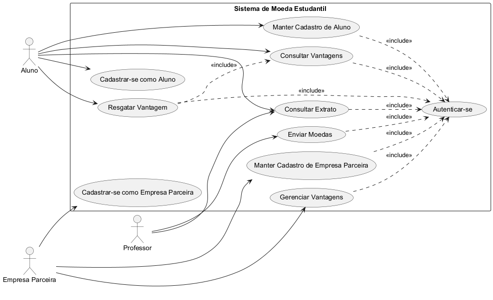
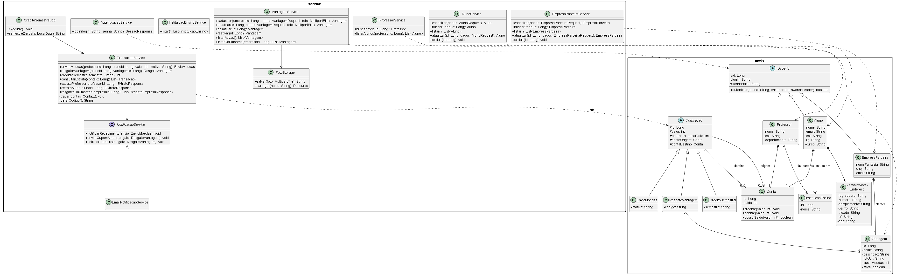
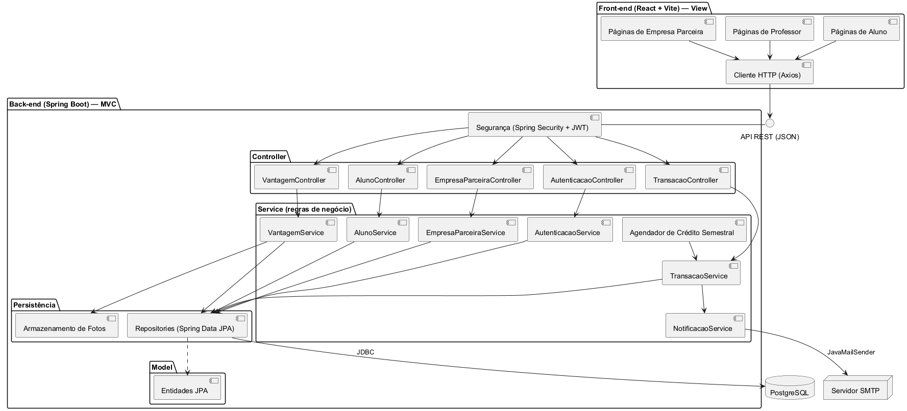
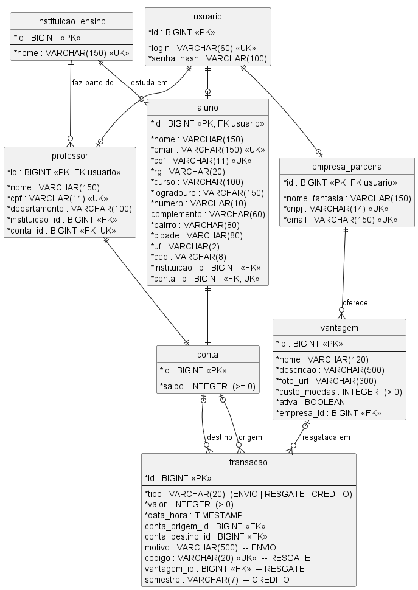
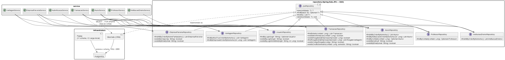

# Sistema de Moeda Estudantil — PUC Minas | Projeto de Software (2S2026)

| Sprint | Entrega | Seções |
|---|---|---|
| **Lab03S01** | Modelagem: casos de uso, histórias de usuário, diagrama de classes e de componentes | 1–7 |
| **Lab03S02** | Modelo ER, estratégia de acesso a dados (ORM + Repository/DAO), CRUDs de aluno e empresa parceira (front-end + back-end) e, adiantado, o fluxo de moedas completo | 8–12 |

## 1. Contexto

Sistema para estimular o reconhecimento do mérito estudantil por meio de uma moeda virtual.
Professores distribuem moedas aos seus alunos; alunos trocam as moedas por vantagens
(produtos e descontos) oferecidas por empresas parceiras.

## 2. Atores

| Ator | Papel |
|---|---|
| **Aluno** | Se cadastra no sistema, consulta extrato, consulta e resgata vantagens com suas moedas. |
| **Professor** | Pré-cadastrado pela instituição. Envia moedas a alunos e consulta o próprio extrato. |
| **Empresa Parceira** | Se cadastra no sistema e cadastra as vantagens que oferece, com custo em moedas. |

Todos os atores autenticam-se com login e senha antes de qualquer operação (exceto o próprio cadastro).

## 3. Regras de negócio extraídas do enunciado

- **RN01** — Cadastro de aluno exige nome, email, CPF, RG, endereço, instituição de ensino e curso.
- **RN02** — Instituições de ensino já estão pré-cadastradas; o aluno apenas seleciona uma delas.
- **RN03** — Professores já estão pré-cadastrados (a instituição envia a lista no momento da parceria), com nome, CPF, departamento e vínculo explícito a uma instituição.
- **RN04** — A cada semestre, cada professor recebe 1.000 moedas. O saldo é acumulável: moedas não distribuídas permanecem e as 1.000 novas são somadas ao saldo corrente. **É um processo de sistema disparado por data (início de semestre), sem ator humano acionando — por isso não aparece como caso de uso no diagrama.**
- **RN05** — Para enviar moedas, o professor precisa ter saldo suficiente, indicar o aluno e informar o motivo do reconhecimento (mensagem aberta, obrigatória).
- **RN06** — Ao receber moedas, o aluno é notificado por email.
- **RN07** — Extrato: o professor vê saldo e envios realizados; o aluno vê saldo, recebimentos e trocas.
- **RN08** — Vantagem cadastrada pela empresa parceira exige nome, descrição, foto do produto e custo em moedas.
- **RN09** — Ao resgatar uma vantagem, o custo é descontado do saldo do aluno (que precisa ter saldo suficiente).
- **RN10** — No resgate, o sistema gera um código único e envia dois emails com esse código: cupom para o aluno (uso na troca presencial) e aviso para a empresa parceira (conferência da troca).
- **RN11** — O **serviço de email** é um sistema externo passivo, apenas acionado pelo sistema. **Não é modelado como ator** no diagrama de casos de uso (não interage buscando um objetivo próprio); aparece no diagrama de componentes como integração (Servidor SMTP).

## 4. Histórias de Usuário

### US01 — Autenticação
**Como** usuário do sistema (Aluno, Professor ou Empresa Parceira),
**quero** informar login e senha,
**para** acessar as funcionalidades correspondentes ao meu perfil.

*Critérios de aceite:*
- Credenciais inválidas impedem o acesso e exibem mensagem de erro.
- Cada perfil só acessa as funcionalidades do próprio papel.
- É pré-condição para todas as demais histórias, exceto US02 e US04 (cadastro).

---

### US02 — Cadastrar-se como aluno
**Como** aluno,
**quero** me cadastrar informando nome, email, CPF, RG, endereço, instituição de ensino e curso,
**para** participar do sistema de mérito.

*Critérios de aceite:*
- Todos os campos da RN01 são obrigatórios.
- A instituição é selecionada de uma lista de instituições pré-cadastradas (RN02).
- CPF e email são únicos no sistema.
- O cadastro define login e senha de acesso.
- O aluno inicia com saldo de 0 moedas.

---

### US03 — Manter cadastro de aluno
**Como** aluno,
**quero** consultar, editar e excluir meu cadastro,
**para** manter meus dados atualizados.

*Critérios de aceite:*
- Edição respeita as mesmas validações do cadastro (US02).
- Um aluno só acessa e altera o próprio cadastro.

---

### US04 — Cadastrar-se como empresa parceira
**Como** empresa parceira,
**quero** me cadastrar no sistema,
**para** oferecer vantagens aos alunos.

*Critérios de aceite:*
- Exige nome, CNPJ e email; CNPJ e email são únicos.
- O cadastro define login e senha de acesso.

---

### US05 — Manter cadastro de empresa parceira
**Como** empresa parceira,
**quero** consultar, editar e excluir meu cadastro,
**para** manter meus dados atualizados.

*Critérios de aceite:*
- Uma empresa só acessa e altera o próprio cadastro.

---

### US06 — Gerenciar vantagens
**Como** empresa parceira,
**quero** cadastrar, editar e desativar as vantagens que ofereço,
**para** que os alunos possam trocá-las por moedas.

*Critérios de aceite:*
- Cadastro exige nome, descrição, foto do produto e custo em moedas (RN08).
- Custo deve ser maior que zero.
- Vantagem desativada deixa de aparecer para os alunos, mas resgates anteriores são preservados no histórico.

---

### US07 — Enviar moedas
**Como** professor,
**quero** enviar moedas a um aluno informando o motivo do reconhecimento,
**para** valorizar bom comportamento, participação em aula etc.

*Critérios de aceite:*
- Bloqueia o envio se o valor for maior que o saldo do professor (RN05).
- O motivo é obrigatório.
- O valor é debitado do professor e creditado ao aluno na mesma operação.
- O aluno recebe email informando valor, professor e motivo (RN06).

---

### US08 — Consultar extrato
**Como** professor ou aluno,
**quero** consultar meu extrato,
**para** ver meu saldo atual e as transações que realizei.

*Critérios de aceite:*
- Exibe saldo atual e transações em ordem cronológica decrescente.
- Professor: créditos semestrais e envios (aluno, valor, motivo, data) (RN07).
- Aluno: recebimentos (professor, valor, motivo, data) e resgates (vantagem, valor, código, data) (RN07).

---

### US09 — Consultar vantagens
**Como** aluno,
**quero** ver as vantagens disponíveis, com descrição, foto, empresa e custo,
**para** escolher em que trocar minhas moedas.

*Critérios de aceite:*
- Lista apenas vantagens ativas.

---

### US10 — Resgatar vantagem
**Como** aluno,
**quero** trocar minhas moedas por uma vantagem,
**para** usufruir do reconhecimento que recebi.

*Critérios de aceite:*
- Bloqueia o resgate se o saldo do aluno for menor que o custo da vantagem (RN09).
- O custo é debitado do saldo do aluno.
- O sistema gera um código único de resgate (RN10).
- O aluno recebe email de cupom com o código; a empresa parceira recebe email com o mesmo código para conferência (RN10).

## 5. Diagrama de Casos de Uso



Fonte PlantUML em [`docs/diagramas/diagrama-caso-de-uso.puml`](docs/diagramas/diagrama-caso-de-uso.puml).

**Notas de escopo:**
- **Crédito semestral de 1.000 moedas** (RN04) não é caso de uso: é processo de sistema disparado por data. No código, vira um job agendado (ver Diagrama de Componentes).
- **Pré-cadastro de instituições e professores** (RN02, RN03) não é caso de uso: o enunciado não define um ator que faça esse cadastro (a lista vem da instituição no momento da parceria). É tratado como carga inicial de dados.
- **Serviço de email** não é ator (RN11).
- **Resgatar Vantagem** inclui **Consultar Vantagens**: o aluno precisa selecionar uma vantagem cadastrada para trocar.

## 6. Diagrama de Classes



Fonte PlantUML em [`docs/diagramas/diagrama-classes.puml`](docs/diagramas/diagrama-classes.puml).

**Decisões de modelagem:**
- **`Usuario`** é classe abstrata (login, senha, `autenticar()`) da qual `Aluno`, `Professor` e `EmpresaParceira` herdam — reflete o `<<include>>` de Autenticar-se no diagrama de casos de uso.
- **`Conta`** concentra saldo e as operações `creditar()`/`debitar()`/`possuiSaldo()`. Aluno e Professor possuem uma conta cada (composição); a empresa parceira não tem saldo. Isso evita duplicar a lógica de saldo nas duas classes e centraliza a validação de saldo suficiente (RN05, RN09).
- **`Transacao`** é abstrata, com conta de origem e de destino (ambas opcionais), especializada em:
  - `EnvioMoedas` — professor → aluno, com `motivo` obrigatório;
  - `ResgateVantagem` — aluno → (sem destino), ligada à `Vantagem` e com o `codigo` gerado;
  - `CreditoSemestral` — (sem origem) → professor, com o `semestre`.
  O extrato (US08) é a lista de transações em que a conta aparece como origem ou destino.
- **`InstituicaoEnsino`** é associada a `Professor` (*faz parte de*) — atende ao "é necessário deixar explícito que ele faz parte de uma instituição" — e a `Aluno` (*estuda em*).
- **`Endereco`** é objeto de valor embutido no aluno (`<<embeddable>>`), não entidade própria.
- **`curso`** do aluno é `String`: o enunciado não pede curso como entidade com atributos próprios.
- Pacote **`service`** concentra as regras de negócio (camada Model do MVC, ver Seção 7). `TransacaoService` faz envio, resgate, crédito semestral e extrato numa transação atômica (débito + crédito + registro). **`NotificacaoService`** é interface, com implementação por email — permite trocar ou simular o envio de email em teste.

## 7. Diagrama de Componentes



Fonte PlantUML em [`docs/diagramas/diagrama-componentes.puml`](docs/diagramas/diagrama-componentes.puml).

**Arquitetura MVC (exigida pelo enunciado):**

| Camada MVC | Componentes |
|---|---|
| **View** | Front-end React (páginas de Aluno, Professor e Empresa Parceira), consumindo a API via cliente HTTP. |
| **Controller** | Controllers REST do Spring Boot — recebem a requisição, validam a entrada e delegam ao service. |
| **Model** | Entidades JPA (diagrama de classes, pacote `model`) + services com as regras de negócio + repositories de acesso a dados. |

**Tecnologias propostas:**

| Item | Tecnologia |
|---|---|
| Back-end | Java 21 + Spring Boot (Web, Validation, Security, Mail) |
| Persistência | Spring Data JPA (Hibernate) + PostgreSQL |
| Autenticação | Spring Security com JWT |
| Email | JavaMailSender via servidor SMTP |
| Crédito semestral | `@Scheduled` do Spring (job agendado) |
| Front-end | React + Vite, Axios |

A estratégia de acesso a dados (ORM via JPA + Repository) e o modelo ER são detalhados na Sprint 2 (Seções 8 e 9).

## 8. Modelo ER (Lab03S02)



Fonte PlantUML em [`docs/diagramas/modelo-er.puml`](docs/diagramas/modelo-er.puml). A fonte de verdade do schema é a migração [`V1__schema_inicial.sql`](backend/src/main/resources/db/migration/V1__schema_inicial.sql); o diagrama a espelha coluna a coluna.

**Do diagrama de classes para as tabelas:**

| Decisão | Mapeamento | Por quê |
|---|---|---|
| Herança `Usuario` → `Aluno` / `Professor` / `EmpresaParceira` | **JOINED**: tabela `usuario` (login, senha) + uma tabela por subclasse, com PK = FK para `usuario` | Login único entre todos os perfis numa só constraint; subclasses têm colunas bem diferentes, então tabela única teria muitas colunas nulas. |
| Herança `Transacao` → `EnvioMoedas` / `ResgateVantagem` / `CreditoSemestral` | **SINGLE_TABLE**: tabela `transacao` com discriminador `tipo` | Cada subclasse acrescenta um único campo; o extrato (US08) lê tudo de uma conta numa consulta sem joins. |
| `Endereco` (`<<embeddable>>`) | Colunas na própria tabela `aluno` | Objeto de valor, sem identidade própria. |
| Composição Aluno/Professor ↔ `Conta` | FK `conta_id` única em `aluno` e `professor` | Relação 1:1; a conta é criada e excluída junto com o dono (cascade). |
| Regras de integridade no banco | `CHECK saldo >= 0`, `CHECK custo_moedas > 0`, `CHECK valor > 0`, `UNIQUE` em CPF, CNPJ, email, login e código de resgate | Última barreira caso uma regra escape da camada de serviço. |
| CPF, CNPJ e CEP | Gravados só com dígitos | A API aceita com ou sem máscara e normaliza antes de gravar. |

## 9. Estratégia de acesso a dados (Lab03S02)

**Escolha: ORM (JPA/Hibernate) + padrão Repository/DAO via Spring Data JPA, com schema versionado pelo Flyway.**



Fonte PlantUML em [`docs/diagramas/diagrama-persistencia.puml`](docs/diagramas/diagrama-persistencia.puml).

- **ORM (JPA/Hibernate):** as entidades do pacote `model` são as classes do diagrama de classes, anotadas com o mapeamento para as tabelas. Mantém modelo e código alinhados (critério de avaliação).
- **Repository (DAO):** cada agregado tem uma interface em `repository` que estende `JpaRepository`. O Spring gera a implementação; consultas específicas usam nomes de método (`existsByCpf`) ou JPQL (`findExtrato`). Os services dependem só das interfaces, nunca de SQL.
- **Flyway:** o schema é criado por migrações SQL versionadas (`V1` schema, `V2` carga inicial), e o Hibernate roda com `ddl-auto=validate`, só conferindo se as entidades batem com o banco. O banco evolui por versão, e qualquer divergência entre modelo e schema derruba a aplicação na subida, em vez de virar erro silencioso.
- **Carga inicial (V2):** instituições (PUC Minas, UFMG, CEFET-MG) e três professores, cada um já com o crédito de 1.000 moedas do semestre 2026-2 registrado como `CreditoSemestral` (RN02, RN03, RN04).
- **Senhas:** só o hash BCrypt é gravado (`usuario.senha_hash`).

**Alternativas consideradas:** JDBC puro com DAOs escritos à mão (mais código repetitivo e o mapeamento objeto-relacional feito manualmente, sem ganho para este domínio) e `ddl-auto=update` no lugar do Flyway (o schema ficaria implícito e não versionado).

**Mudanças no diagrama de classes nesta sprint:** os métodos `cadastrar`/`atualizar` de `AlunoService` e `EmpresaParceiraService` passaram a receber DTOs de requisição (`AlunoRequest`, `EmpresaParceiraRequest`) em vez da entidade, porque a requisição traz dados que não pertencem à entidade (senha em texto puro, id da instituição). Entrou também o `InstituicaoEnsinoService`, que alimenta a seleção de instituição no cadastro de aluno (RN02).

## 10. CRUDs de aluno e empresa parceira (Lab03S02)

**Fluxo MVC:** tela React → Axios → Controller REST → Service (regras) → Repository → PostgreSQL.

| Método | Rota | Descrição |
|---|---|---|
| GET | `/api/instituicoes` | Instituições pré-cadastradas |
| GET | `/api/alunos` | Lista alunos (com instituição e saldo) |
| GET | `/api/alunos/{id}` | Consulta aluno |
| POST | `/api/alunos` | Cadastra aluno (US02), saldo inicial 0 |
| PUT | `/api/alunos/{id}` | Edita aluno (US03); senha em branco mantém a atual |
| DELETE | `/api/alunos/{id}` | Exclui aluno; bloqueado se houver movimentação de moedas |
| GET | `/api/empresas` | Lista empresas parceiras |
| GET | `/api/empresas/{id}` | Consulta empresa |
| POST | `/api/empresas` | Cadastra empresa (US04) |
| PUT | `/api/empresas/{id}` | Edita empresa (US05) |
| DELETE | `/api/empresas/{id}` | Exclui empresa e suas vantagens; bloqueado se alguma vantagem já foi resgatada |

**Respostas de erro:** `400` com erro por campo (validação), `404` (não encontrado), `422` (regra de negócio: CPF/CNPJ/email/login duplicado, senha ausente no cadastro, exclusão bloqueada). As telas exibem a mensagem geral e o erro embaixo de cada campo.

**Telas (self-service):** o CRUD é feito pelo próprio dono do cadastro, como pedem US03/US05 ("só acessa e altera o próprio cadastro"). *Create* em **Sou aluno** / **Sou empresa**, que já entra no sistema ao final; *Read* e *Update* em **Meu cadastro**; *Delete* em **Meu cadastro → Excluir minha conta**, com confirmação. Não há tela pública listando todos os alunos: ela exporia CPF e endereço de terceiros. As rotas de listagem da API continuam disponíveis.

## 11. Fluxo de moedas (Lab03S02, adiantado)

Implementa as histórias US01 e US06 a US10 em cima do schema que já existia, sem migração nova.

| Etapa | Quem | Tela | Regras |
|---|---|---|---|
| Entrar | Todos | **Entrar** | Confere login e senha (hash BCrypt) e identifica o perfil, que define o menu (US01). |
| Crédito semestral | Sistema | — | Job `@Scheduled` em 1º/fev e 1º/ago, e também na subida da aplicação. Soma 1.000 moedas ao saldo de cada professor e é idempotente por semestre: rodar de novo não credita duas vezes (RN04). |
| Enviar moedas | Professor | **Reconhecer alunos** → botão *Reconhecer* | Exige saldo suficiente, quantidade > 0 e motivo; o aluno precisa ser da instituição do professor. Débito, crédito e registro numa só transação; o aluno recebe email (US07, RN05, RN06). |
| Cadastrar vantagens | Empresa | **Painel** → *Nova vantagem* | Nome, descrição, foto (JPG/PNG/WEBP/GIF, até 5 MB) e custo > 0. Desativar tira a vantagem da vitrine e preserva o histórico de resgates (US06, RN08). |
| Resgatar | Aluno | **Vantagens** | Só vantagens ativas; exige saldo. Gera código único de 8 caracteres e envia dois emails com o mesmo código: cupom ao aluno e aviso à empresa (US09, US10, RN09, RN10). |
| Extrato | Professor e aluno | **Extrato** | Saldo e transações da mais recente para a mais antiga, com sinal do ponto de vista de quem consulta (US08). |
| Conferir troca | Empresa | **Painel** → *Conferir código* | A empresa digita o código apresentado pelo aluno e vê se é válido, de qual vantagem e de qual aluno; lista todos os resgates recebidos (RN10). |

**Painéis por perfil:** cada ator entra num painel próprio. O professor vê saldo, data do próximo crédito, alunos da instituição e reconhecimentos recentes. O aluno vê saldo, reconhecimentos recebidos, a vitrine (com quanto falta para cada vantagem) e os cupons. A empresa vê a conferência de código, as suas vantagens e os resgates recebidos.

**Decisões de implementação:**

- **"Seus alunos" = alunos da mesma instituição.** O enunciado não modela turma; o vínculo explícito do professor é com a instituição (RN03). O envio para aluno de outra instituição é recusado.
- **Concorrência de saldo.** Antes de conferir o saldo, o `TransacaoService` trava as contas envolvidas (`SELECT ... FOR UPDATE`, em ordem de id para evitar deadlock). Sem isso, dois envios simultâneos poderiam ler o mesmo saldo e um sobrescrever o outro. O `CHECK (saldo >= 0)` do banco continua como última barreira.
- **Email só depois do commit.** O `EmailNotificacaoService` monta a mensagem durante a transação e envia no `afterCommit`: nenhum email avisa de uma operação desfeita, e uma falha de SMTP não desfaz a transferência (fica registrada no log).
- **Fotos em disco**, com nome aleatório gerado pelo servidor e servidas por `/api/fotos/{arquivo}` (componente "Armazenamento de Fotos" do diagrama de componentes).
- **Login sem token nesta versão.** O back-end confere a senha e devolve o perfil; o front guarda a sessão no navegador. As rotas da API ainda não exigem token. A proteção com Spring Security + JWT, impedindo um usuário de agir em nome de outro, fica para a Sprint 3.

**Rotas adicionadas:**

| Método | Rota | Descrição |
|---|---|---|
| POST | `/api/auth/login` | Login → `{id, perfil, nome}` |
| GET | `/api/professores/{id}` | Professor com saldo |
| GET | `/api/professores/{id}/alunos` | Alunos que o professor pode reconhecer |
| POST | `/api/professores/{id}/envios` | Envia moedas `{alunoId, valor, motivo}` |
| GET | `/api/professores/{id}/extrato` | Extrato do professor |
| GET | `/api/alunos/{id}/extrato` | Extrato do aluno |
| POST | `/api/alunos/{id}/resgates` | Resgata `{vantagemId}` → código do cupom |
| GET | `/api/vantagens` | Vantagens ativas (vitrine) |
| GET | `/api/vantagens/{id}` | Consulta vantagem |
| GET | `/api/empresas/{id}/vantagens` | Vantagens da empresa (ativas e desativadas) |
| POST | `/api/empresas/{id}/vantagens` | Cadastra vantagem (multipart: `dados` JSON + `foto`) |
| PUT | `/api/vantagens/{id}` | Edita vantagem (foto opcional) |
| POST | `/api/vantagens/{id}/desativar` · `/reativar` | Liga/desliga a vantagem na vitrine |
| GET | `/api/fotos/{arquivo}` | Foto da vantagem |
| GET | `/api/empresas/{id}/resgates` | Resgates das vantagens da empresa, com código e aluno |

**Testes automatizados** (`backend/src/test`): 21 testes de integração MockMvc rodando as mesmas migrações Flyway num H2 em modo PostgreSQL, mais testes unitários de `Conta`. Cobrem os CRUDs (cadastro, normalização, validação, duplicidade, edição sem troca de senha, exclusão e bloqueios de exclusão) e o fluxo de moedas: login por perfil, envio com débito/crédito e extratos, saldo insuficiente, motivo obrigatório, aluno de outra instituição, vantagem com foto obrigatória, resgate com código, vantagem desativada, crédito semestral acumulável e idempotente e cálculo do semestre. O fluxo também foi validado de ponta a ponta no PostgreSQL e no Mailpit.

**Fica para a Sprint 3:** proteção das rotas com Spring Security + JWT, versão final dos CRUDs e slides da arquitetura e da camada de persistência.

## 12. Como executar

Pré-requisitos: Java 21, Maven, Node 20+ e Docker.

```bash
# 1. Banco (PostgreSQL 16 na porta 5434) e servidor de email de teste (Mailpit)
docker compose up -d

# 2. Back-end (http://localhost:8080); o Flyway cria o schema e a carga inicial na primeira subida
cd backend
mvn spring-boot:run

# 3. Front-end (http://localhost:5180); o Vite encaminha /api para o back-end
cd frontend
npm install
npm run dev

# 4. (opcional) Dados de demonstração, com o back-end rodando e o banco recém-criado
node scripts/popular-demo.mjs
```

O script `scripts/popular-demo.mjs` cria, pela própria API e passando pelas mesmas regras de negócio, 5 alunos, 5 empresas parceiras, 7 vantagens com foto, 7 reconhecimentos e 2 resgates. Para recomeçar do zero: `docker compose down -v`, `docker compose up -d`, reinicie o back-end e rode o script de novo.

Testes do back-end: `cd backend && mvn test` (não precisam do Docker).

**Emails enviados pelo sistema:** caixa de entrada do Mailpit em http://localhost:8025.

**Contas:**

| Perfil | Login | Senha | Origem |
|---|---|---|---|
| Professor | `prof.ana`, `prof.bruno` (PUC Minas), `prof.carla` (UFMG) | `prof123` | carga inicial (V2) |
| Aluno | `maria.silva`, `joao.pereira`, `beatriz.costa`, `lucas.almeida` (PUC Minas), `pedro.santos` (UFMG) | `aluno123` | script de demonstração |
| Empresa | `cantina.coracao`, `livraria.paginaviva`, `papelaria.pontovirgula`, `horizonte.idiomas`, `academia.movimento` | `empresa123` | script de demonstração |

A tela **Entrar** tem atalhos que preenchem uma conta de cada perfil.

**Roteiro de demonstração (≈5 min):**
1. Entre como `prof.ana` → **Reconhecer** um aluno: escolha a quantidade, um motivo e envie. O saldo cai no cabeçalho.
2. Abra http://localhost:8025: o aluno recebeu o email com o motivo.
3. Entre como `maria.silva` → o reconhecimento aparece no painel → **Resgatar** uma vantagem → confirme. O código do cupom aparece na tela e chega por email.
4. Entre como a empresa da vantagem → **Conferir código** com o código do cupom: aparece "Código válido", com vantagem e aluno.
5. Mostre o **Extrato** do professor e do aluno e, na empresa, *Nova vantagem* com a prévia de como o aluno verá.
6. CRUD: **Sou aluno** (cadastro), **Meu cadastro** (consulta, edição e exclusão da própria conta).
